<!-- 자동 생성: bin/s9-guide-md 가 web/guide.html 에서 변환한다. 직접 수정하지 말 것 — 원본(html) 수정 후 재실행. -->

# section9 사용자 가이드

verified 2026-09-06 · dashboard http://127.0.0.1:9909 · 캡처는 실제 화면(개발 인스턴스, 2026-09-06) · 맥은 실측 전    

## 1. section9이 뭔가요

터미널에서 Claude Code 에게 일을 시키면, 요청 하나하나가 자동으로 카드가 되어 기록됩니다. 대시보드에서 그 카드들의 진행을 실시간으로 보고, 끝난 작업을 승인하거나 반려합니다. section9 은 AI 작업의 **외부기억(모든 것이 문서로 남음)**이자 **관제탑(보고 판정하는 화면)**입니다.

여러분이 할 일은 둘뿐입니다 — 터미널에서 평소처럼 일을 시키는 것, 그리고 가끔 대시보드를 열어 확인 대기 중인 카드를 판정하는 것. 기록·상태 관리·재작업은 시스템이 합니다.

### 내부 구조 — 한 장으로

| 조각 | 무엇인가 | 어디에 있나 |
| --- | --- | --- |
| **타치코마** | 여러분과 대화하는 리드입니다. 요청을 카드로 접수하고, 전문 영역은 역할 에이전트에게 나눠 주고, 결과를 시험해 판정을 청합니다. 응답 첫 줄이 `[시각 - 타치코마]` 이면 리드가 말하는 것이고, `[시각 - designer]` 처럼 역할명이면 위임된 에이전트의 보고입니다 | Claude Code 세션 |
| **역할 에이전트 29** | `s9-agnt-<역할>` — designer·backend-developer·security-engineer·document-writer 등. 타치코마가 위임하는 전문가들입니다 | `~/.claude/agents/` (설치가 놓음) |
| **스킬** | `s9-skl-<스킬>` 11개 + `s9-design`·`s9-protocol`. 에이전트가 일하기 전에 읽는 기준 문서입니다 | `~/.claude/skills/` |
| **훅** | Claude Code 의 세션 시작·프롬프트·종료 순간마다 실행돼 요청을 카드로 만들고 기록을 남기는 자동 기록 장치입니다 | `~/.claude/settings.json` |
| **vault** | 모든 문서 — 요청(REQ)·지식(DOC)·세션(SES)·프로젝트(PRJ). 마크다운 파일이고 git 으로 오갑니다. 이것이 유일한 원본입니다 | `vault/` |
| **대시보드** | vault 를 읽어 보여 주고 판정을 받는 화면. 서버는 `s9 serve`, 감시자가 종료된 서버를 되살립니다 | `http://127.0.0.1:9909` |
| **s9** | 명령줄 도구. 화면이 하는 모든 일을 터미널에서도 합니다. Python 3 표준 라이브러리만 씁니다 — 설치할 패키지가 없습니다 | `bin/s9` |

이름 앞의 `s9-agnt-`·`s9-skl-` 은 이름 공간입니다 — 여러분이 이미 쓰던 같은 이름의 에이전트·스킬과 겹치지 않도록 우리 것이 다른 이름으로 섭니다.

## 2. 최초 설치

section9 은 **git 저장소 하나**가 곧 설치 단위입니다. 두 가지 방식이 있고, 설치 절차는 같습니다.

| 방식 | 무엇을 clone 하나 | 누구에게 맞나 |
| --- | --- | --- |
| **① section9 저장소 자체** | section9 저장소(또는 그 fork)를 그대로 작업 공간으로 씁니다. 코드와 문서가 한 저장소에 있습니다 | 혼자 쓰거나, 집·회사 두 기계에서 같은 저장소를 쓰는 주인. 이 가이드의 기본 경로입니다 |
| **② 팀 인스턴스 저장소** | 관리자가 `s9 instance init` 으로 만든 사설 저장소. 코드는 들어 있고, 데이터만 팀 것입니다 | 여러 사람이 한 팀으로 쓰는 경우 — 9장 |

예시는 clone 위치를 `~/section9` 로 통일합니다. 실제로는 아무 경로나 됩니다 — clone 한 그 디렉토리가 곧 작업 공간입니다.

0 **선행 조건 셋** 

**git**, **Python 3**(추가 패키지 없음), **Claude Code CLI**. 로그인은 지금 하지 않아도 됩니다 — 3장의 첫 실행에서 자연스럽게 뜹니다.

```
npm install -g @anthropic-ai/claude-code   # 또는 공식 네이티브 인스톨러
```

1 **저장소를 받습니다** 

두 번째 기계라면 첫 기계와 **같은 GitHub 저장소**를 받습니다 — 그래야 6장의 동기화가 성립합니다.

```
git clone git@github.com:<계정>/section9.git ~/section9
```

2 **설치 스크립트를 실행합니다** 

```
cd ~/section9 && bin/s9-install
```

Windows(WSL 아님)에서는 `bin\s9-install.cmd`. 몇 번을 다시 실행해도 같은 결과입니다(멱등) — pull 뒤에는 git 훅이 알아서 다시 실행합니다.

3 **출력을 읽습니다** 

실제 출력의 앞부분입니다. 마지막에 `section9 install 완료` 와 로그인 확인 줄이 있으면 성공입니다.

```
dirs OK: /home/<계정>/section9
git hooks OK: post-merge, post-checkout, pre-commit(guard), post-commit(기록)
merge driver OK: merge.s9doc → s9 merge-doc
claude hooks 최신 상태
  skill(공용): s9-design -> ~/.claude/skills/
  skill(공용): s9-protocol -> ~/.claude/skills/
  skill(공용): s9-skl-browser-verify -> ~/.claude/skills/
  … (스킬 13개)
  agent(공용): s9-agnt-ai-engineer.md -> ~/.claude/agents/
  … (역할 에이전트 29개)
대시보드 기동: http://127.0.0.1:9909/ (감시 포함)
section9 install 완료
예전 설정 N개를 ~/.local/state/section9/backups/claude/<시각> 에 그대로 복사해 두었습니다. …
로그인 확인: claude
```

4 **열려 있던 Claude Code 세션을 껐다 켭니다** 

스킬과 역할 에이전트는 세션이 **시작될 때**만 읽힙니다. 켜는 방법은 3장의 `s9 code` 입니다.

### 설치가 놓는 것과 건드리지 않는 것

| 놓는 것 | 어디에 |
| --- | --- |
| 디렉토리 골격 | `vault/ users/ projects/ state/ index/` |
| git 훅 넷 | `.git/hooks/` — post-merge·post-checkout(인덱스 재생성 + 설치 재실행), pre-commit(s9-guard: 보호 경로·동시 작업 검사), post-commit(commit 을 요청 문서에 기록) |
| merge driver | `merge.s9doc` — 문서가 양쪽에서 바뀌면 줄이 아니라 뜻으로 합칩니다 |
| Claude Code 훅 | `~/.claude/settings.json` — 명령에 `/section9/bin/` 이 든 항목만 우리 것으로 보고 교체·추가합니다. 여러분의 다른 훅·설정은 그대로입니다. 이 훅은 **section9 디렉토리 안에서 연 세션에서만** 움직입니다 — 다른 디렉토리의 작업은 기록하지도 건드리지도 않고, 등록되지 않은 계정의 세션은 잇는 길만 안내합니다(REQ-20260906-074) |
| 스킬 13 · 역할 에이전트 29 | `~/.claude/skills/` · `~/.claude/agents/` |
| 설치 전 백업 | `~/.local/state/section9/backups/claude/<시각>/` — settings.json·CLAUDE.md·메모리. **자격증명은 읽지도 복사하지도 않습니다.** 되돌리기는 7장 |

옵션: `--quiet`(조용히) · `--no-claude`(Claude 훅·스킬·에이전트 생략) · `--backup ask|silent|off`(설치 전 백업 방식, 기본 silent) · `--uninstall`(7장).

**서버가 꺼져도 걱정 없습니다.** 대시보드 서버는 재부팅 등으로 꺼져 있어도 다음 Claude Code 세션이 시작될 때 자동으로 다시 시작됩니다. 수동으로 띄우려면 `~/section9/bin/s9 serve`. 

## 3. 첫 실행 — `s9 code` 한 줄

터미널을 열고 아래 한 줄을 실행합니다. 어느 디렉토리에서 실행해도 됩니다. PATH 에 `~/section9/bin` 을 넣어 두면 `s9 code` 만 쳐도 됩니다.

```
~/section9/bin/s9 code
```

`s9 code` 는 실행 전에 스스로 점검하고, 순서대로 이렇게 진행합니다.

- **포트를 고릅니다.** 9909 에 내 서버가 답하면 그대로, 비어 있어도 그대로. 다른 저장소의 section9 이나 다른 프로그램이 앉아 있으면 **9910~9949 에서 빈 포트를 골라** `state/port` 에 적고 그 사실을 한 줄로 알립니다(8장). 
- **대시보드를 보장합니다.** 꺼져 있으면 감시자와 함께 띄웁니다 — `대시보드 실행 중: http://127.0.0.1:9909/`. 
- **훅이 없으면 설치합니다** — `◌ 설치 완료 — 지금 시작하는 세션부터 자동 audit이 적용된다.` 
- **옛 설정의 승계를 한 번만 제안합니다.** 설치가 복사해 둔 예전 CLAUDE.md·메모리에 옮길 만한 줄이 있으면 알립니다. 묻지 않고 넣지는 않습니다 — 고르려면 `s9 env inherit`(7장). 
- **미등록 계정이면 이름을 묻습니다.** 터미널에서는 이렇게 뜹니다 — Enter 만 치면 OS 계정명으로 등록됩니다. 

```
◌ 미등록 사용자다. 등록할 이름(Enter=<OS 계정>): 
```

 터미널이 아닌 곳(파이프·자동 실행)에서는 묻지 않고 `◌ 미등록 사용자(<계정>) — 등록하려면: s9 user add <계정>` 만 남깁니다. 
- **Claude Code 를 이 저장소 기준으로 띄웁니다.** 규약·스킬·역할 에이전트가 여기서 읽힙니다. 

### 로그인

**Claude 에 로그인돼 있지 않아도 됩니다.** 이어서 뜨는 Claude Code 화면에서 `/login` 안내를 따르면 그대로 세션이 시작됩니다. 설치 직후에도 같은 말이 나옵니다: `claude 는 설치됐지만 로그인이 없다 — … 그다음 s9 code`. 계정이 둘 이상이면 `s9 account` 로 만들고·보고·바꿉니다.

### 계정 등록과 연결 — 세 경우

| 경우 | 할 것 |
| --- | --- |
| 이 저장소를 처음 쓰는 사람 | `s9 code` 가 물을 때 Enter — 또는 미리 `s9 user add <이름>`. **첫 사람은 admin 으로**: `s9 user add <이름> --role admin` (사용자 관리·저장소 pull·push 가 admin 몫입니다) |
| OS 계정명과 다른 이름으로 등록해 둔 사람 | `s9 user attach <이름>` — 이 OS 계정·이 기계를 그 이름에 한 번만 연결합니다 |
| **두 번째 기계**(집의 맥미니 등)에서 같은 저장소를 받은 주인 | 등록은 이미 저장소 안(`users/<이름>/profile.md`)에 들어 있으니 **`s9 user attach <이름>` 만** — 6장 |

대시보드는 **서버를 띄운 OS 계정으로 나를 자동 인식**합니다 — 고를 것이 없습니다. 우상단에 **이름 @ 기계 [역할]** 이 뜨고, 승인·반려가 이 이름으로 기록됩니다. 미등록이면 그 자리에 등록 안내가 뜹니다.

### 그다음은 그냥 일을 시키면 됩니다

프롬프트 입력창에 **평소 말하듯 한국어로** 입력합니다. section9 을 의식하고 쓸 것은 없습니다.

| 이렇게 치면 | 이렇게 됩니다 |
| --- | --- |
| *"결제 모듈에 환불 API 추가해줘"* | REQ 카드가 자동으로 생기고(화면에 기록 안내가 뜹니다), 착수→완료까지 대시보드에서 추적됩니다 |
| *"이 함수는 왜 이렇게 짰어?"* | 질문으로 분류 — 카드 없이 답만 받습니다. Audit 탭에는 남습니다 |
| *"앞으로 보고는 세 줄 이내로 해줘"* | 개인 선호로 저장 — 다음 턴부터, 다음 세션에서도 계속 적용됩니다 |
| *"타치코마, 지금 뭐 하고 있어?"* | 리드를 이름으로 부른 것입니다. 진행 중 작업의 요약(digest)으로 답합니다 |

권한 모드 등 claude 인자는 뒤에 그대로 붙입니다: `s9 code --permission-mode acceptEdits`. 계정 기본값으로 저장하려면 `s9 user config <이름> s9code_args '--permission-mode acceptEdits'`. 세션을 끝내려면 `Ctrl+C` 또는 `/exit`. 다시 시작하면 진행 중 작업 요약(digest)을 자동으로 넘겨받으므로 "아까 어디까지 했지?"를 물을 필요가 없습니다. WSL 사용자는 WSL 셸에 들어온 뒤 실행합니다.

### 알아 두면 좋은 명령 여섯

전부 선택 사항입니다. 대시보드로도 같은 것을 봅니다.

| 명령 | 용도 |
| --- | --- |
| `s9 digest` | 지금 진행 중인 작업의 전체 요약 — "어디까지 됐지?"의 답 |
| `s9 ls --status in-progress` | 상태·사용자별 요청 목록 (`--user`, `--project` 조합 가능) |
| `s9 show REQ-20260906-040` | 요청 문서 하나의 전문 — 원문·작업 기록·이력 |
| `s9 search 결제 --body` | 본문까지 포함한 키워드 검색 |
| `s9 blocked` | 대기 중인 요청과 대기 사유 일람 |
| `s9 doctor` | 서버·포트·훅·로그인·저장소 상태를 한 번에 진단 (8장) |

## 4. 카드의 일생 — 요청 → 진행 → 확인 대기 → 승인/반려 → 완료

터미널에 입력한 요청 하나가 어떻게 흘러가는지만 이해하면 전부 이해한 것입니다.

터미널 프롬프트 "결제 모듈 구현해줘"  자동 기록   REQ 카드 open — 접수  착수    in-progress 작업 중 · 녹색 점멸=실작업  완료 보고   review 사람의 판정 대기  ✓ 승인   done 완료  ↺ 반려 — 사유를 적어 되돌림 ~30초 안에 백그라운드 작업이 반려 사유를 반영해 다시 review 로 올림 ⛔ blocked = 사람의 손이나 다른 작업을 기다림 (사유가 카드에 표시)    

| 상태 | 화면의 말 | 무슨 뜻인가 · 누가 옮기나 |
| --- | --- | --- |
| open | 요청 | 터미널에서 일을 시킨 순간 만들어집니다. 여러분이 따로 등록할 것은 없습니다 |
| in-progress | 진행 | 타치코마가 착수하면 옮깁니다. 카드 왼쪽의 점이 "지금 실제로 실행 중인가"를 말합니다(아래 표) |
| blocked | 대기 | 사람의 확인이나 다른 요청의 완료를 기다립니다. 카드에 **대기 사유**가 그대로 보이고, 기다리던 요청이 done 이 되면 자동으로 풀립니다 |
| review | 확인 대기 | 사람만 답할 수 있는 판정을 청하는 자리입니다. 카드에 **확인 포인트**(무엇을 눌러 보고 무엇이 보이면 승인인지) 가 보라색으로 뜹니다. 기계로 확인되는 것은 타치코마가 스스로 닫습니다 |
| done | 완료 | **✓ 승인**을 누르면 옮겨집니다. 승인 메모를 적으면 타치코마가 후속 작업으로 받습니다 |
| ↺ 반려 | — | **↺ 반려**를 누르고 사유를 적으면 in-progress 로 돌아갑니다. 약 30초 안에 백그라운드 작업이 사유를 읽고 재작업해 다시 review 로 올립니다 — 자리를 지킬 필요가 없습니다 |
| cancelled | 취소 | 하지 않기로 한 요청. 목록에서 내려가되 기록은 남습니다 |

### 카드 위의 실시간 신호 읽기

in-progress 카드 왼쪽의 점은 "문서상 진행 중"이 아니라 **지금 이 순간의 실제 동작**을 나타냅니다.

| 점 | 의미 | 해석 |
| --- | --- | --- |
| 녹색 점멸 | 일하는 중 · 기록도 나감 | 이 요청을 맡은 것이 2분 내에 실제로 움직였고, 문서에도 적히고 있습니다. 가장 확실한 신호. |
| 녹색 링 + 심 | 작업 중 · 기록은 아직 | 작업은 실행 중인데 문서에 아직 적힌 것이 없습니다. 기다리면 위 녹색으로 바뀝니다. |
| 녹색 링 | 실행 중이지만 아직 맡지 않음 | 이 요청을 만든 창이 다른 일을 하는 중이거나, 백그라운드 작업이 막 떠서 아직 문서를 집기 전입니다. 잠깐 기다립니다. 어느 쪽인지는 점에 마우스를 올리면 나옵니다. |
| 속 빈 사각 | 멈춤 | 붙어 있는 것도 없고 문서도 한동안 그대로입니다. 카드의 **▶ 이어가기**로 멈춘 자리에서 이어받게 할 수 있습니다. |
| 채운 사각 | 맡았던 작업이 종료됨 | 이 요청을 맡았던 작업이 도중에 종료됐습니다. 까닭이 남아 있으면 점에 마우스를 올렸을 때 함께 보입니다. |
| 줄 그은 사각 | 사람이 중단해 둠 | 사람이 손으로 중단해 둔 요청입니다. **▶ 이어가기**를 누르기 전에는 저절로 이어지지 않습니다. |
| 작은 회색 링 | 모름 | 진행 중으로 기록돼 있지만 신호가 없습니다. 방치된 것일 수 있으니 눈여겨보세요. |

모양이 「무엇이 붙어 있나」, 채움이 「기록이 나가고 있나」를 말합니다 — 색은 둘째 신호라, 색을 못 보는 눈에도 일곱이 그대로 갈립니다.

진행 중인 요청에 담당이 없으면 서버가 백그라운드 작업을 띄워 이어받습니다 — 여러분이 자리를 비워도 요청은 멈추지 않습니다. 요청마다 끌 수 있습니다: 문서 화면 맨 위의 **자동 이어받기 끄기**.

### TDD 배지와 blocked 표시

- TDD 3/5 — 검증 커버리지입니다. 이 작업이 스스로 정한 검증 시나리오 5개 중 3개를 통과했다는 뜻. TDD 5/5 가 다 차야 review 로 올라올 수 있습니다. **반려하면 시나리오가 개정되어 0부터 다시 채워집니다** — 숫자가 준 것처럼 보여도 정상입니다. 
- **⛔ 대기 사유** — blocked 카드에는 "무엇을 기다리는지"가 그대로 표시됩니다. 사람의 손이 필요한 것(예: GitHub 에서 저장소 만들기)이면 그 일을 해 주면 풀립니다. 

## 5. 화면별 사용법

대시보드는 여덟 탭입니다. 상단 필터(검색 · 본문 · 사용자 · 내 것만 · 프로젝트 · 태그 · 종류)는 모든 탭에 공통으로 적용됩니다. 우상단에는 **이름 @ 기계 [역할]** 과 서버가 말하는 사실(자동 복구 횟수 등)이 뜹니다.

### Board kanban

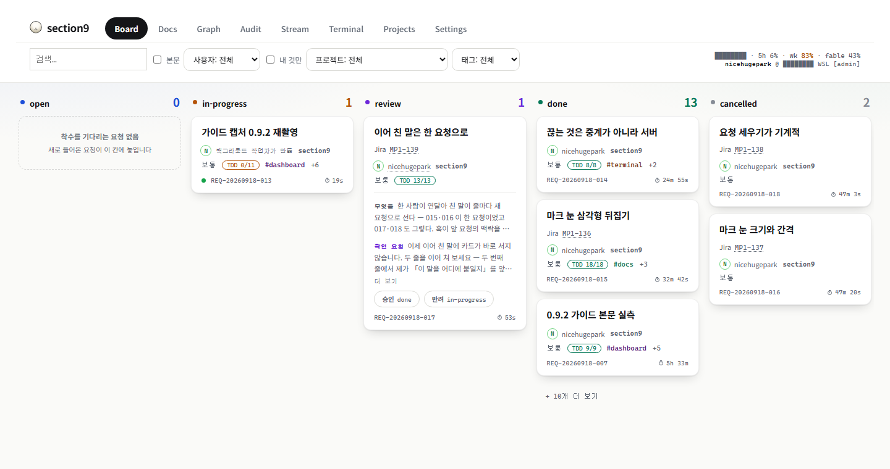

Board — open · in-progress · blocked · review · done · cancelled 여섯 열. 카드마다 담당·만든이·크기·TDD 배지·태그·경과 시간. blocked 카드에는 대기 사유가 그대로 선다

- 상태별 열(open → in-progress → blocked → review → done · cancelled)에 요청 카드가 놓입니다. 열 머리의 숫자가 건수이고, 넘치면 **+ N개 더 보기**. 
- 카드 한 장: 제목 · 담당(**N** 아이콘 + 이름) · 만든이(사람 또는 타치코마) · 우선순위 · 크기(S/M/L) · TDD n/n · #태그 · REQ 번호 · 그 상태에 머문 시간. 
- **review 카드에서 바로 판정합니다**: **✓ 승인** = done, **↺ 반려** = 사유를 적어 재작업. 카드의 보라색 글이 "무엇을 확인해 달라는지"(확인 포인트)입니다. 
- 카드를 **드래그**해 다른 열에 놓아도 상태가 바뀝니다 — 허용되는 열만 점선으로 표시됩니다. 
- 담당 이름을 누르면 담당을 바꿀 수 있습니다. 멈춘 카드에는 **▶ 이어가기**·**깨우기** 버튼이 붙습니다. 
- 상단 **내 것만**을 켜면 내가 멤버인 프로젝트의 문서만 남습니다. 

### Docs 문서 목록 · 뷰어

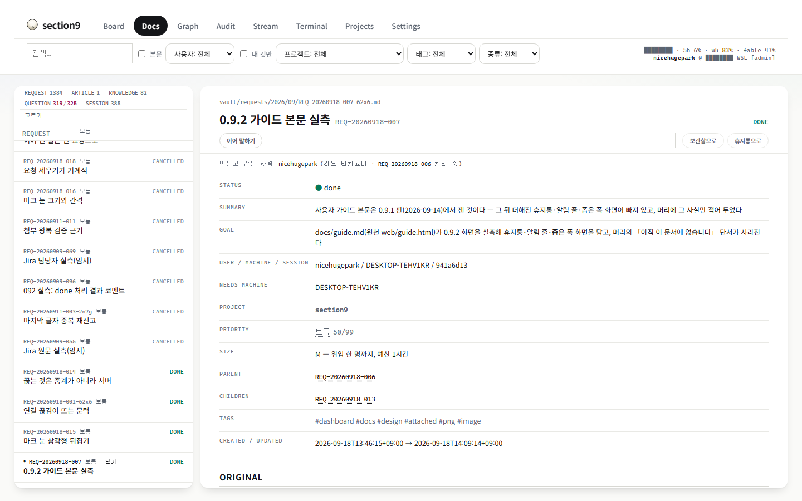

Docs — 왼쪽 목록 머리의 REQUEST · ARTICLE · KNOWLEDGE · QUESTION · SESSION 이 종류별 건수이자 필터. 오른쪽이 뷰어

- 왼쪽 목록에서 문서를 고르면 오른쪽에 전문이 열립니다. 요청 문서는 **원문(Original) + 작업 기록(Notes) + 상태 이력(History)**의 완결된 기록입니다. 첨부(캡처·로그)는 문서 안에 그림으로 그려집니다. 
- 목록 머리의 종류 이름을 누르면 그 종류만 남습니다. **보관함 · 휴지통**에는 보관한 문서와 지운 문서가 있습니다. 
- 문서 상단의 전이 버튼(→ done, → review …)로 이 화면에서도 상태를 바꿀 수 있습니다. blocked 에는 사유를, review 에는 확인 포인트를 적습니다. 
- 요청 문서 하단의 **"이 요청의 스트림"**을 펼치면, 이 요청을 처리한 터미널 구간이 그대로 재생됩니다 — 무슨 명령을 치고 무슨 결과를 받았는지 확인할 수 있습니다. 
- 검색창 옆 **본문**을 켜면 제목뿐 아니라 본문까지 검색됩니다. 

### Graph 관계도

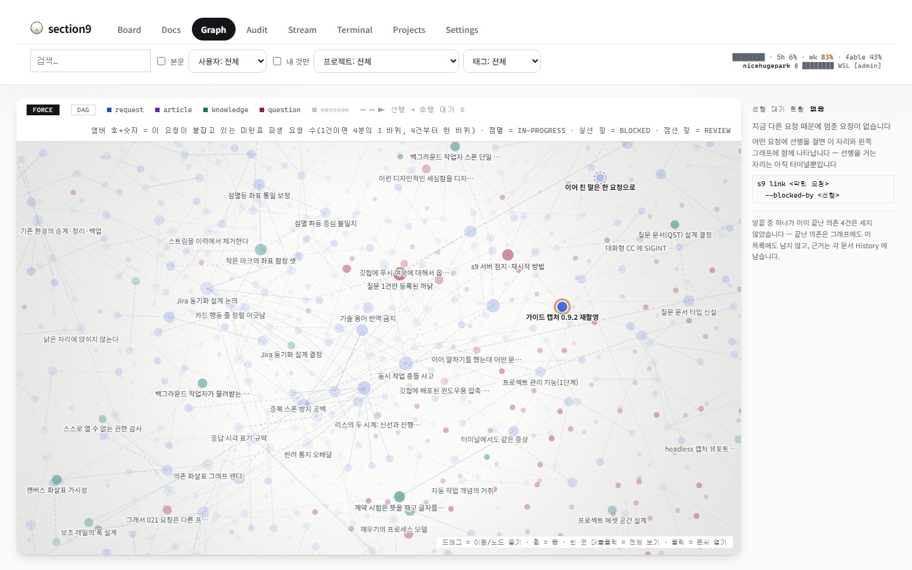

Graph — 문서 관계도. 범례의 종류 이름을 눌러 켜고 끈다(session 은 기본 숨김). 오른쪽 「선행 대기」 패널이 지금 다른 요청 때문에 멈춘 요청을 말한다

- 문서 사이의 관계(부모-자식·참조·선행)를 봅니다. 노드를 드래그하고, 휠로 확대하고, 두 번 누르면 그 문서가 열립니다. 
- **앰버 호 + 숫자가 병목입니다**: 끝나지 않은 파생 작업 N건이 이 문서에 매달려 있다는 뜻. 호가 클수록 병목이 큽니다. 링은 상태입니다 — 점멸 in-progress · 실선 blocked · 점선 review. 
- **FORCE**(물리 배치) / **DAG**(계층 배치)로 시점을 바꿉니다. 
- 오른쪽 **선행 대기** 판: 진행이 막힌 요청에 선행을 걸면(`s9 link <막힌 요청> --blocked-by <선행>`) 여기에 줄이 서고 그래프에 화살표가 그려집니다. 
- 세션 노드는 기본으로 숨겨져 있습니다. 범례의 `session` 을 누르면 켜집니다. 

### Audit 이벤트 타임라인

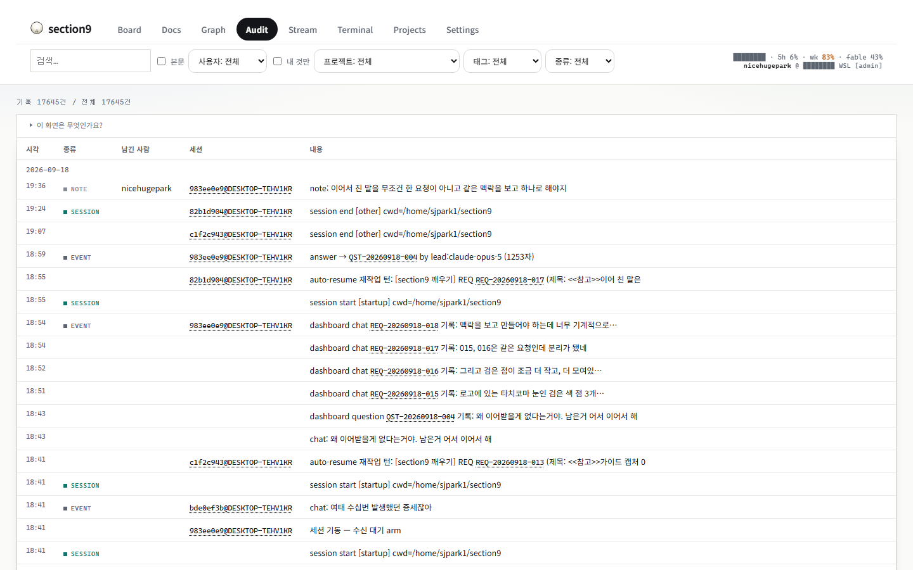

Audit — 모든 세션의 프롬프트·응답·질문 이벤트가 최신순으로

- "언제 누가 무엇을 시켰고 무엇이 돌아왔나"를 한 줄씩 최신순으로 보여 줍니다. 카드가 되지 않은 단순 질문(QUESTION)도 여기에는 남습니다. 
- 이벤트 속 REQ 번호를 누르면 해당 문서로 이동합니다. 

### Stream 세션 기록

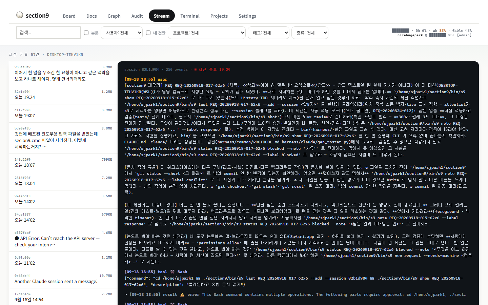

Stream — 세션 하나의 터미널 흐름. 진행 중이면 ● live, follow 를 켜 두면 실시간으로 따라간다

- 세션을 고르면 그 세션의 터미널이 통째로 재생됩니다 — 사용자 발화, 타치코마의 응답, 도구 호출(⚒), 결과. 
- 진행 중인 세션은 **● live** 가 붙고, follow 를 켜 두면 턴 중간에도 실시간으로 따라갑니다. 

### Terminal 채팅 · 지금 실행 중인 세션

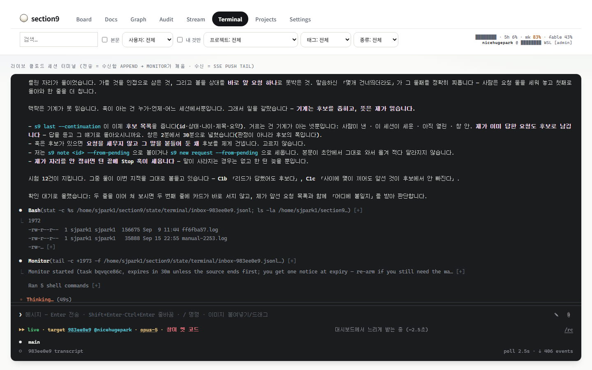

Terminal — 위는 지금 실행 중인 세션의 화면, 아래는 메시지 입력과 대상 세션(target). 맨 아래 띠가 지금 일하고 있는 역할 에이전트 목록

Stream 이 기록이라면 Terminal 은 **지금 실행 중인 세션과의 대화**입니다. 터미널 창을 두고 나왔어도 브라우저에서 이어서 말을 걸 수 있습니다.

- **메시지** — Enter 로 보냅니다. Shift+Enter·Ctrl+Enter 는 줄바꿈, `/` 로 시작하면 명령, 이미지는 붙여넣기나 드래그. 보낸 말은 그 세션의 수신함에 들어가고 타치코마가 다음 차례에 읽습니다 — 터미널에서 친 것과 같은 프롬프트로 취급됩니다. 
- **target** 줄 — 어느 세션에 보내는지(세션 번호 · @사용자 · 모델)와 그 세션이 live 인지. `s9 code` 로 연 세션이 자동 대상의 첫 순위입니다. 세션이 옛 코드로 떠 있으면 **창이 옛 코드** 라고 알립니다. 
- **에이전트 띠** — 지금 타치코마가 위임해 일하고 있는 역할 에이전트(`s9-agnt-…`)와 각자의 경과 시간·토큰. 병렬로 무엇이 돌고 있는지 여기서 봅니다. 
- 세션이 서버의 말을 듣고 있는지는 `s9 doctor --live` 가 진단합니다(8장). 

### Projects 프로젝트 — 일을 묶고 격리하기

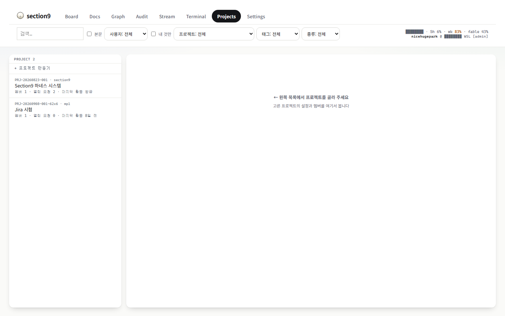

Projects — 왼쪽이 프로젝트 목록(번호 · slug · 이름 · 멤버 · 열린 요청 · 마지막 활동)과 「+ 프로젝트 만들기」, 오른쪽이 고른 프로젝트의 정보 패널

카드가 쌓이면 "결제 건", "사내 도구 건"처럼 **일감 단위로 묶고 싶어집니다**. 프로젝트가 그 묶음입니다 — 요청·문서·화면을 프로젝트 단위로 모아 보고, **멤버가 아닌 사람에게는 그 프로젝트의 문서가 보이지 않게** 격리합니다. 보안 경계 자체가 다른 조직·고객이라면 프로젝트가 아니라 인스턴스를 분리(9장)하는 것이 맞습니다.

**만들기** — 화면의 **+ 프로젝트 만들기**, 또는 터미널 한 줄. 만든 사람이 owner 가 되고, `pay` 자리가 **slug**(짧은 식별자, 영문·숫자·`._-`)입니다.

```
~/section9/bin/s9 project add pay --name "결제 시스템"
PRJ-20260824-002  (pay)  owner=<이름>
  ↳ 에셋 공간: projects/pay/ — CONTEXT.md(진입점) + assets/
```

**요청이 어느 프로젝트의 것인지는 이렇게 정해집니다** (REQ-20260906-050) — 추측하지 않고, 아래 순서에서 **처음 맞는 것** 하나로 정합니다. 어느 길로 붙었는지는 요청 문서의 `project_source` 에 남습니다.

| 순서 | 신호 | `project_source` |
| --- | --- | --- |
| ① | 터미널에서 `s9 new request --project pay` 로 직접 준 값. 권한이 없으면 거절됩니다 | `explicit` |
| ② | 프롬프트 **첫 줄**의 표기 `[프로젝트: pay]` 또는 `[project: pay]` — 훅이 떼어 넘기고 제목에서는 지웁니다 | `tag` |
| ③ | 세션에 묶인 프로젝트 — `s9 code --project pay` 로 열었거나, `projects/` 에 등록된 프로젝트가 **하나뿐**이면 그것. 세션 도중에는 `s9 bind project pay` 로 바꿉니다 | `session` |
| ④ | 내가 기여(contribute)할 수 있는 프로젝트가 **하나뿐**이면 그것 | `only` |
| ⑤ | 위에 아무것도 없으면 **빈 값**. 타치코마에게 「프로젝트 미정 — 후보: a, b」 한 줄이 주입되고, 사람은 나중에 `s9 set <id> --project pay` 또는 Board 카드에서 붙입니다 | (없음) |

②③④ 는 권한이 없거나 등록되지 않은 slug 면 조용히 다음 순서로 내려갑니다. **직전 요청의 프로젝트를 물려받지 않고, 문장을 읽어 추측하지도 않습니다** — 화제가 바뀐 프롬프트가 옛 프로젝트에 조용히 붙는 것보다 빈 값이 낫습니다. 상단 **프로젝트** 필터의 「미지정」으로 빈 것을 모아 볼 수 있습니다.

귀속된 요청이 접수되면 그 프로젝트의 **CONTEXT.md 가 세션에 자동 주입**됩니다 — 배경 설명을 매번 반복하지 않아도 됩니다.

**멤버와 역할** — 프로젝트를 고르면 열리는 정보 패널에서 멤버 추가·역할 변경·만료일·제거를 인라인으로 합니다. 상단 **프로젝트** 필터로 골라도 Board·Docs·Graph 위에 같은 패널이 열립니다.

| 역할 | 할 수 있는 일 |
| --- | --- |
| `viewer` | 열람만 |
| `contributor` | + 기여 — 이 프로젝트로 요청·문서를 만들 수 있음 (새 멤버의 기본 역할) |
| `maintainer` | + 관리 — 프로젝트 설정 변경, 멤버 추가·제거·역할 변경 |
| `owner` | + 소유 — owner 지정·변경까지. 마지막 owner 는 제거·강등할 수 없습니다(새 owner 를 먼저 지정) |

**프로젝트 공간** `projects/<slug>/` — 자리는 셋입니다.

| 위치 | 무엇을 넣는 곳인가 |
| --- | --- |
| `CONTEXT.md` | 프로젝트의 배경·용어·핵심 링크·저장소 정책을 담는 **단일 진입점**. 요청 접수 시 세션에 자동 주입됩니다 |
| `assets/` | 작업 재료 — 스펙·회의록·데이터 샘플·외부 API 문서. **비밀번호·API 키·개인정보는 넣지 마세요** — 멤버 전원과 AI 세션이 읽는 공유 재료함이고 암호화되지 않습니다 |
| `agents/` | 이 프로젝트 전용 에이전트 정의(`*.md`). 다음 세션부터 `<slug>--이름` 으로 쓸 수 있습니다. `worker.md` 는 반려 재작업의 프롬프트 템플릿으로 자동 주입됩니다. 확인·즉시 반영: `s9 project agents ls` / `sync` |

주소에 `?project=pay` 를 붙여 열면 처음부터 그 프로젝트로 좁혀진 화면이 열립니다 — 동료에게 링크로 줄 때 편합니다.

### Settings 계정 · 개인화 · 저장소 · 시스템

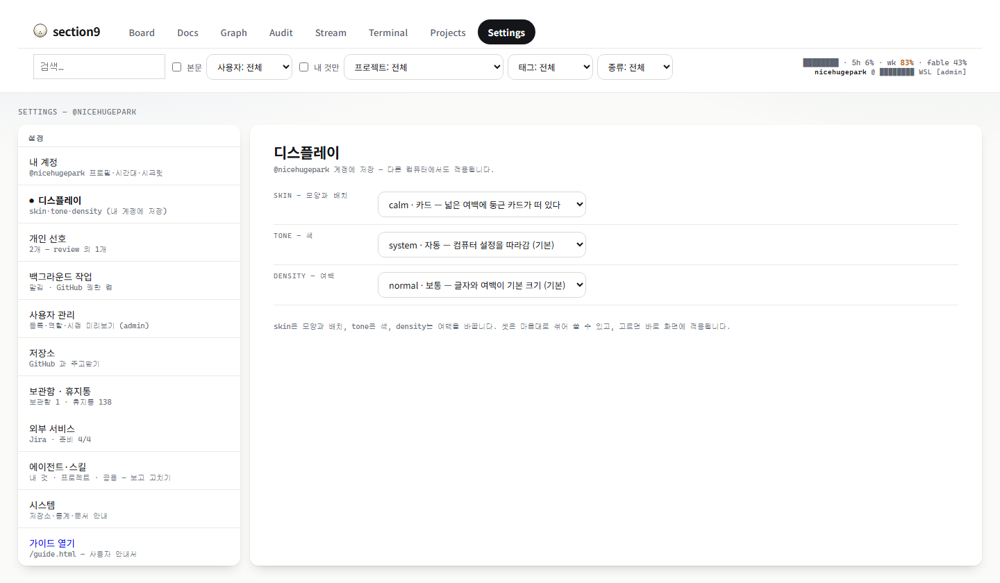

Settings — 왼쪽 목록이 여덟 절: 디스플레이 · 내 계정 · 백그라운드 작업 · 사용자 관리 · 저장소 · 에이전트·스킬 · 시스템 · 가이드 링크. 오른쪽이 고른 절

왼쪽 목록의 순서가 **나 → 나 → 남 → 저장소 → 시스템**입니다. 절마다 무엇을 하는지 순서대로 적습니다.

**디스플레이** — 대시보드의 겉모습. **skin**(디자인 언어) × **tone**(색) × **density**(밀도) 세 축을 자유롭게 조합하고, 바꾸는 즉시 적용됩니다. 등록 계정이면 계정에 저장되어 어느 기계에서나 같은 모습입니다.

**내 계정** — 프로필(표시 이름 · 이메일 · GitHub 계정)과 **개인 선호(pref)**. "반말로 짧게 보고" 같은 말투·작업 방식 선호를 저장해 두면 타치코마가 매 턴 반영합니다. 여기서 직접 추가·수정·삭제해도 되고, 터미널에서 *"앞으로 반말로 해줘"*라고 말하면 자동으로 저장됩니다. 미기재 항목이 있으면 목록에 **⚠ 미기재 N** 이 붙습니다.

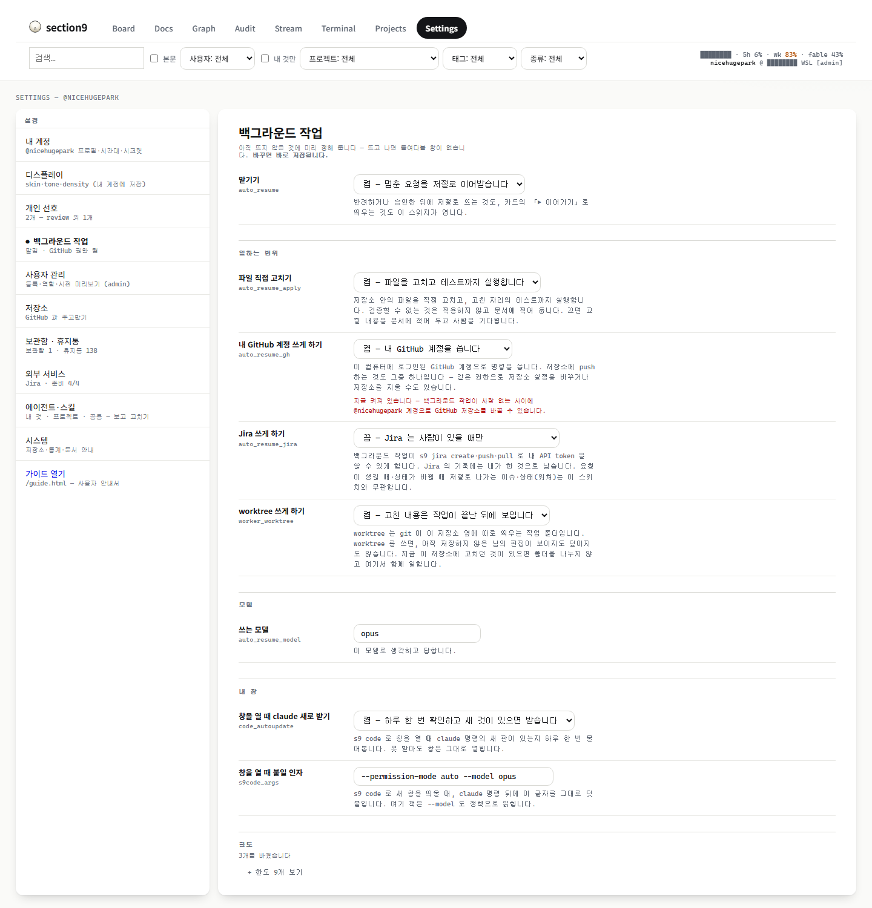

Settings › 백그라운드 작업 — 스위치 셋. 맡기기가 으뜸 스위치이고 나머지 둘은 그 아래에 딸린다

**백그라운드 작업** — 사람이 없는 사이에 요청을 이어받는 작업자에게 무엇을 허락할지. 스위치 셋이고 **계정별** 설정입니다.

| 스위치 | 켬 | 끔 |
| --- | --- | --- |
| **맡기기** (으뜸) | 멈춘 요청을 저절로 이어받습니다 — 반려하면 약 30초 안에 재작업이 뜹니다 | 사람이 직접 이어갑니다. 꺼져 있어도 잃는 것은 없습니다 — 반려된 요청은 그 세션의 다음 프롬프트나 새 세션이 시작되는 순간 최우선으로 재개됩니다 |
| **고치기까지** | 파일을 고치고 테스트까지 실행합니다 (web·vault·tests 안에서만) | 고칠 내용을 적어만 두고 사람을 기다립니다 (기본) |
| **GitHub 권한** | 내 GitHub 계정으로 명령을 씁니다 — 켤 때 확인 창이 한 번 뜹니다 | GitHub 은 건드리지 않습니다 |

터미널에서는 `s9 user config <이름> auto_resume on`. 이 스위치들은 **컴퓨터마다 따로**입니다 — 저장소에 실려 다른 컴퓨터로 가지 않습니다. 이 컴퓨터에서 백그라운드 작업을 돌릴지는 이 컴퓨터의 사정이고, 저장소에 실으면 저장소에 push 할 수 있는 누구나 남의 컴퓨터에서 그것을 켤 수 있게 됩니다. 대신 **켜져 있다는 사실**은 실려 갑니다: 「담당 컴퓨터 바꾸기」의 목록이 컴퓨터마다 맡기기 켜짐/꺼짐을 적어, 일을 받지 못하는 컴퓨터에 요청을 배정하는 일을 그 자리에서 알려 줍니다.

**사용자 관리** — admin 전용. 등록·역할(admin/member/viewer) 관리와 **시점 미리보기**(다른 사용자의 화면을 그대로 확인). 시점 미리보기 중에는 남의 이름으로 저장소를 바꾸지 않도록 pull·push 가 잠깁니다. admin 이 아니면 "admin 전용"이라고만 뜹니다.

### Settings › 저장소 pull · push

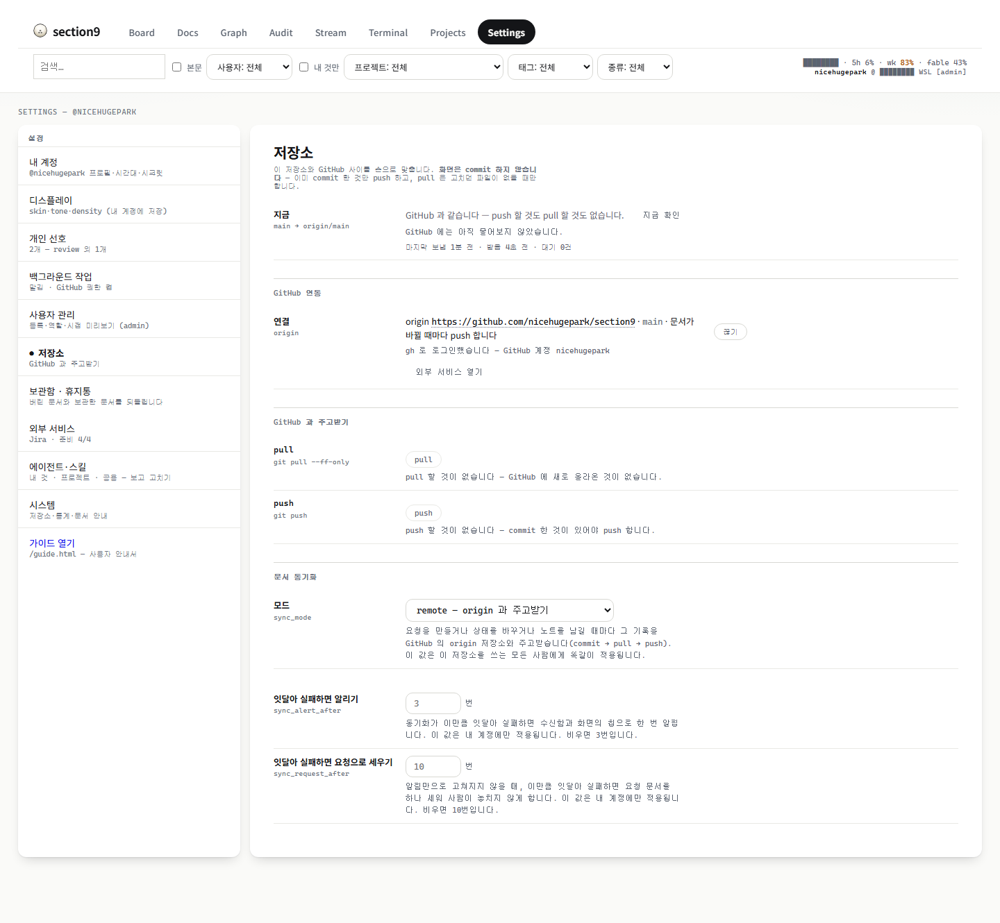

Settings › 저장소 — 지금 어디에 서 있는지(main → origin/main), push 할 것·pull 할 것·고치던 파일의 셈, 잠긴 버튼 옆의 사유 한 줄

이 저장소와 GitHub 사이를 **화면에서 손으로 맞추는** 판입니다. 터미널을 열어 `git pull`·`git push` 를 직접 치지 않아도 되고, 이 저장소가 GitHub 과 얼마나 벌어졌는지도 화면이 말해 줍니다. 6장이 켜져 있으면 문서 이벤트마다 저절로 오가므로 이 판은 **확인하고 손으로 맞추는 자리**가 됩니다.

**판을 열지 않아도 거리가 보입니다.** 좌측 목록의 **저장소** 줄 밑에 「push 할 것 2개 · pull 할 것 1개 · 고치던 파일 12개」가 부제로 붙기 때문입니다. 판을 열면 같은 셈이 큰 글씨로 서고, 그 왼쪽에 지금 어디에 서 있는지가 `main → origin/main` 으로 뜹니다.

- **push 할 것 N개** — 여기서 이미 commit 했는데 GitHub 에는 아직 없는 것. 
- **pull 할 것 N개** — GitHub 에 새로 올라왔는데 여기에는 아직 없는 것. 
- **고치던 파일 N개** — 아직 commit 하지 않은 편집. 파일 이름까지 펼쳐 볼 수 있습니다. 

**셈마다 나이가 다릅니다.** push 할 것과 고치던 파일은 이 컴퓨터 안에서만 세면 되므로 이 패널이 열려 있는 동안 10초마다 다시 셉니다. pull 할 것은 GitHub 에 물어야 알 수 있어서 **저절로 묻지는 않습니다** — 며칠 열어 둔 화면이 30초마다 물으면 하루에 2,880번을 두드리게 됩니다. 사람이 **지금 확인**을 누를 때와 pull·push 앞뒤에만 묻고, 대신 나이를 숨기지 않습니다: 「GitHub 에는 5분 전에 물어봤습니다」. 한 번도 안 물어봤으면 그렇다고 적습니다.

**이 패널이 하지 않는 일 셋.** ① 화면은 **commit 하지 않습니다** — 이미 commit 한 것만 push 합니다. ② 여기와 GitHub 이 각각 앞서 **갈래가 갈리면 합치지 않습니다** — 어떻게 합칠지는 사람이 정할 일입니다. ③ 고치던 파일을 **치워 두었다 되돌리지 않습니다** — 그 명령이 남의 미완성 작업을 지운 적이 있어서, 이 화면은 아예 부르지 못하게 짜여 있습니다. 버튼 왼쪽의 회색 문구(`git pull --ff-only`·`git push`)가 화면이 실제로 실행하는 명령 전부입니다 — 숨은 강제 옵션도, 합치는 방식을 고르는 인자도 없습니다. 

**push 만 확인 창을 지납니다.** 무엇이 나가는지(짧은 해시와 제목)를 보여 주고 묻습니다. 한 번 나간 것은 다른 사람도 가져가므로 이 화면에서는 되돌릴 수 없기 때문입니다. pull 은 창 없이 바로 하고, 끝나면 「파일 N개가 바뀌었습니다」로 결과를 말합니다. 방금 오간 commit 목록은 그 밑에서 펼쳐 볼 수 있습니다.

### 버튼이 잠기는 이유

잠긴 버튼 옆에는 언제나 **왜 못 하는지가 한 줄로 서 있습니다** — 눌러 봐야 아는 화면을 만들지 않으려는 것입니다. 그 문장은 서버가 짓고, 누른 순간 서버가 같은 판정을 한 번 더 합니다. 그래서 버튼 옆 사유와 실제 거절 사유가 갈리지 않습니다. 사유가 여럿 겹쳐도 **먼저 걸린 하나만** 보입니다.

pull·push 를 **둘 다 잠그는 사유는 일곱**입니다. 위에 있는 것이 먼저 걸립니다.

- **이 자리는 git 저장소가 아닙니다.** clone 한 자리가 아니라 그냥 만든 디렉토리에 설치된 경우입니다 — 2장의 설치를 다시 보세요. 
- **GitHub 의 어느 갈래와도 짝지어 두지 않았습니다.** 터미널에서 `git push -u origin main` 을 **한 번** 해 두면 그다음부터는 화면에서 됩니다. 화면이 그 명령을 그대로 적어 줍니다. 
- **지금 @누구 시점으로 보는 중입니다.** admin 이 Settings › 사용자 관리의 **시점 미리보기**로 남의 화면을 보는 동안에는 둘 다 잠깁니다 — 저장소를 바꾸는 일은 남의 이름으로 하지 않습니다. 내 시점으로 돌아오면 열립니다. 
- **저장소를 바꾸는 일은 admin 만 합니다.** 거리를 읽는 것은 등록 사용자 모두 됩니다 — 잠기는 것은 버튼 둘뿐입니다. 
- **여기와 GitHub 에 각각 새 commit 이 있습니다.** 갈래가 갈린 것입니다. 합치는 일은 화면이 하지 않으니, 터미널에서 `git pull --rebase` 로 맞춘 뒤 다시 오세요. 
- **지금 실행 중인 작업 N건이 있습니다.** 백그라운드 작업이 이 저장소의 파일을 아직 바꾸고 있습니다. 화면 오른쪽 위의 「실행 중 N건」과 같은 숫자입니다 — 끝나면 저절로 열립니다. 
- **GitHub 에 묻지 못했습니다.** 90초 안에 답이 없거나 연결이 안 될 때입니다. git 이 남긴 마지막 한 줄이 그대로 뜹니다. 잠시 뒤 **지금 확인**을 다시 눌러 보세요. 

여기에 더해, **한쪽만 잠기는 자리가 셋** 있습니다.

- **pull** — **고치던 파일이 N개 있습니다.** pull 하면 덮일 수 있어서, commit 한 뒤에 pull 할 수 있습니다. push 는 이것으로 막히지 않습니다 — 나가는 것은 이미 commit 한 것뿐이니까요. 
- **pull** — **pull 할 것이 없습니다.** GitHub 에 새로 올라온 것이 없다는 뜻입니다. 방금 확인한 것이 아니라면 **지금 확인**을 먼저 눌러 보세요. 
- **push** — **push 할 것이 없습니다.** commit 한 것이 있어야 push 합니다. 고치던 파일은 commit 하기 전까지 여기에 세지 않습니다. 

### Settings › 에이전트·스킬

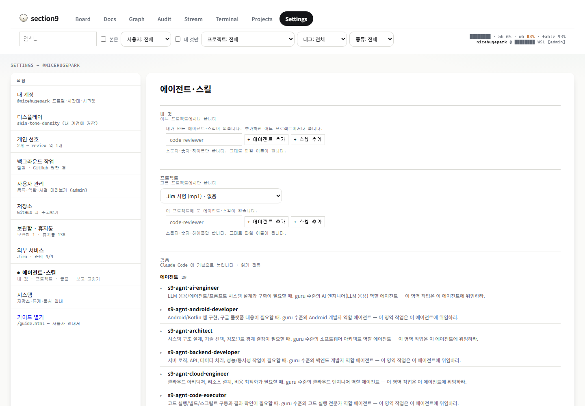

Settings › 에이전트·스킬 — 내 것 · 프로젝트 · 공용 세 범위를 한 판에. 앞의 둘은 여기서 고치고, 공용은 읽기 전용

타치코마가 부르는 역할 에이전트와 스킬을 **보고 고치는** 자리입니다. 범위가 셋입니다.

| 범위 | 무엇인가 | 여기서 고치나 |
| --- | --- | --- |
| **내 것** | 내 계정에만 있는 에이전트·스킬. 새로 만들면 이름과 한 줄 설명을 채운 틀이 열립니다 | 고칩니다 |
| **프로젝트** | `projects/<slug>/agents/` 의 정의. 다음 세션부터 `<slug>--이름` 으로 섭니다 | 고칩니다 |
| **공용** | `s9-agnt-*` 29 · `s9-skl-*` 와 `s9-design`·`s9-protocol`. Claude Code 에 기본으로 놓이는 생성물입니다 | 읽기 전용 — 원천 `harness/claude/gen_roster.py` 를 고치고 `s9-install` 을 다시 실행합니다 |

### Settings › 시스템

저장소 경로 · 문서 통계 · 문서 안내. 이 가이드로 가는 링크(`/guide.html`)가 목록 맨 아래에 있습니다.

### 프로젝트 정보 패널과 열람 격리 누가 무엇을 보나

상단 **프로젝트** 필터에서 프로젝트를 고르면 Board·Docs·Graph 위에 **프로젝트 정보 패널**이 열립니다. 멤버 추가·제거, 역할, 참여 만료일을 여기서 관리합니다(Projects 탭과 같은 판).

**열람 격리**: 화면에 보이는 문서는 서버가 자동 인식한 내 계정에 따라 다릅니다. 일반 사용자는 자기가 멤버인 프로젝트의 문서(그리고 자기가 만든 문서)만 보이고, admin 은 전체가 보입니다. 사람마다 목록이 다른 것은 고장이 아니라 이 격리가 동작하는 것입니다. admin 은 Settings › 사용자 관리의 **시점 미리보기**로 다른 사용자의 화면을 그대로 확인할 수 있습니다.

## 6. 두 기계 동기화 — GitHub 만으로

회사 노트북과 집의 맥미니처럼 **한 사람이 두 기계**에서 같은 저장소를 쓰는 길입니다. ssh 로 두 기계를 잇지 않습니다 — **GitHub 저장소 하나**가 가운데에 있고, 양쪽이 각자 push·pull 합니다.

### 원리 — 표식 하나, 문서 이벤트마다 commit → pull → push

- 저장소 뿌리의 **`.s9-sync`** 파일이 표식입니다. **있으면** "여기는 동기화하는 자리"이고, **내용이 모드**입니다: `local`(이 기계 안에서 commit 만) 또는 `remote`(commit → pull --rebase → push). 표식이 없으면 어떤 git 쓰기도 일어나지 않습니다 — 코드만 보려고 clone 한 사람에게는 아무 일도 없습니다. 
- 표식은 **git 에 담겨 다닙니다.** 그래서 두 번째 기계는 clone 하는 순간 첫 기계의 모드를 **물려받습니다**. 따로 켤 것이 없습니다. 
- remote 모드에서는 문서가 만들어지거나 상태가 바뀔 때마다(문서 이벤트) 저절로 commit 하고, pull --rebase 로 상대 기계의 것을 받고, push 합니다. 오가는 것은 **문서뿐**입니다: `vault/ users/ projects/ .s9-sync`. 대화 원문(streams)과 기계 상태(state/)는 가지 않습니다. 
- 같은 문서를 양쪽에서 고치면 merge driver 가 뜻으로 합칩니다(노트는 이어 붙이고, 상태는 나중 것). 그래도 못 합치면 **충돌**로 서고, 사람이 고릅니다(아래). 

### 첫 기계에서 — 떠나기 전에 확인할 셋

- **GitHub 에 저장소가 있고 origin 이 그것입니다.** `git remote -v` 에 `origin` 이 GitHub 주소로 서 있어야 합니다. 요청·지식 문서가 실리므로 **Private** 을 권합니다 — `s9 doctor` 가 public 이면 그 사실을 알려 줍니다. 
- **동기화가 켜져 있고 표식이 commit 돼 있습니다.** 

```
~/section9/bin/s9 sync --status
마지막 보냄 9분 전 · 받음 7초 전 · 대기 0건
모드: remote  (commit→pull→push)  마커 /home/<계정>/section9/.s9-sync 존재
```

 모드가 비어 있으면 `s9 sync --on` 으로 켭니다. 그리고 `git status .s9-sync` 가 조용해야(commit 돼 있어야) 두 번째 기계가 물려받습니다. 「대기 N건」은 아직 보내지 못한 commit 수입니다 — 0 이 아니면 push 권한이나 연결을 먼저 봅니다. 
- **내 등록이 저장소 안에 있습니다.** `users/<이름>/profile.md` 가 git 에 담겨 있으면(`git ls-files users/`) 두 번째 기계는 등록 없이 연결만 하면 됩니다. 

### 두 번째 기계에서 — 네 줄

1 **GitHub 에 push 할 수 있게 합니다** 

이 기계의 SSH 키를 GitHub 계정에 등록하거나(Settings › SSH and GPG keys), 저장소에 **쓰기 권한이 있는 deploy key** 를 두거나, HTTPS 라면 토큰을 씁니다. 확인은 한 줄:

```
ssh -T git@github.com     # "Hi <계정>! You've successfully authenticated…" 이면 됩니다
```

push 권한이 없으면 문서는 만들어지되 「대기 N건」이 쌓이기만 합니다 — 잃지는 않습니다.

2 **같은 저장소를 받고 설치합니다** 

```
git clone git@github.com:<계정>/section9.git ~/section9
cd ~/section9 && bin/s9-install
```

clone 에 `.s9-sync` 가 함께 왔으므로 이 순간부터 remote 모드입니다.

3 **이 기계를 내 이름에 연결합니다** 

```
bin/s9 user attach <이름>
<이름>: attached <OS 계정>@<기계>
```

등록(`user add`)은 하지 않습니다 — 프로필이 저장소에 이미 있습니다. 첫 기계에서 표식을 켜지 않았더라도, 두 번째 기계가 붙는 이 순간 origin 이 있으면 저절로 remote 로 켜지고 그렇게 말해 줍니다: `두 번째 머신이 붙었다 — 이 저장소는 이제 바깥과 오간다…`

4 **평소처럼 시작합니다** 

```
bin/s9 code
```

대시보드 우상단에 **이름 @ 이 기계 [역할]** 이 뜨고, 첫 기계에서 만든 카드가 Board 에 그대로 보이면 끝입니다. 확인은 `s9 sync --status`.

### 일상 — 무엇이 저절로 되고, 무엇을 손으로 하나

**다른 기계에서 재야 하는 일** — 요청에 `s9 set <id> --needs-os macOS` 처럼 판을 적어 두면, 그 판의 기계에서 여는 다음 세션이 `s9 next` 에서 「이 기계에서 해야 할 요청」으로 먼저 받습니다. 동기화만 있으면 되고 원격 접속은 필요 없습니다(REQ-20260906-080).

| 일 | 어떻게 되나 |
| --- | --- |
| 문서 만들기 · 상태 바꾸기 · 노트 | 저절로 commit → pull → push. 상대 기계는 다음 문서 이벤트나 폴링 때 받습니다 |
| 코드(bin·web·harness) 변경 | 저절로 가지 않습니다. 사람이 commit·push 하고, 상대 기계에서 `git pull` — pull 뒤 훅이 설치를 다시 실행합니다 |
| 개인 선호(pref)·디스플레이 | `users/<이름>/config/` 에 있어 함께 갑니다. 백그라운드 작업 스위치는 기계별이라 가지 않습니다 |
| 잠시 끄기 · 다시 켜기 | `s9 sync --off`(이 기계 안에서 commit 만) · `s9 sync --on`. 환경변수 `S9_SYNC=off` 는 그 명령 한 번만 끕니다 |
| 지연 보기 | `s9 sync --stats` — 단계별 지연 p50/p95 와 거부율 |

### 충돌 — `s9 sync resolve`

두 기계가 같은 문서를 서로 다르게 고치고 merge driver 도 못 합치면, 전송이 그 자리에서 서고 `s9 sync --status` 에 **충돌 — s9 sync resolve 필요** 가 뜹니다. 그 뒤로는 push 도 pull 도 밀립니다. 푸는 법은 문서마다 한쪽을 고르는 것입니다.

```
~/section9/bin/s9 sync resolve REQ-20260906-040 --take mine     # 내 로컬 본으로 확정
~/section9/bin/s9 sync resolve REQ-20260906-040 --take theirs   # GitHub(origin) 본으로 확정
```

- 고르기 전에 양쪽 본을 `state/sync-conflict/<id>.mine.md` · `.theirs.md` 로 남깁니다 — 진 쪽이 사라지지 않습니다. 
- 지목하지 않은 문서가 충돌하면 기계가 대신 고르지 않고 멈춘 뒤 그 id 를 알려 줍니다. 
- 아직 보내지 못한 commit 을 파일로 뽑아 두려면 `s9 sync rescue` — `state/sync-rescue/*.patch`. 

**맥은 아직 실측 전입니다.** 이 절차는 리눅스·WSL 에서 검증됐고, 맥에서는 「세션이 실행 중인지의 판정」과 「사파리 렌더」 두 결함이 실측을 기다리는 채 열려 있습니다(REQ-20260903-006). 맥미니에서 처음 설치할 때 무엇이 걸리는지 `s9 doctor --live` 출력과 함께 요청으로 남겨 주시면 그 결과로 이 절이 고쳐집니다. 

## 7. 되돌리기 — `s9 env restore` · `s9 uninstall` · `s9 reset`

셋은 되돌리는 범위가 다릅니다. 셋 다 **먼저 `--dry-run` 으로 무엇이 바뀔지 보고**, 셋 다 문서(vault·users·projects)와 자격증명은 건드리지 않습니다.

| 명령 | 되돌리는 것 | 그대로 두는 것 |
| --- | --- | --- |
| `s9 env restore <시각\|latest>` | 설치가 복사해 둔 **설치 전 Claude 설정**(settings.json · CLAUDE.md · 메모리)을 제자리로. 지금 파일과 같으면 건너뛰고, 다르면 지금 것을 이름 바꿔 둔 뒤 되돌립니다 | 저장소 전체 · 훅 · 자격증명 |
| `s9 uninstall` | **설치가 놓은 것만** — Claude 훅 항목 · `s9-agnt-*` · `s9-skl-*` 등 스킬 · git 훅 · 설치 표식. 기본으로 설치 전 백업도 함께 되돌립니다(`--keep` 이면 백업은 두고 놓은 것만 제거) | 저장소 · 문서 · 자격증명 · 여러분의 다른 훅 |
| `s9 reset` | **기계 상태만** — `state/`·`index/`(포트·세션 바인딩·작업 목록·인덱스). 자동으로 백업을 남기고 비웁니다. 되돌리기는 `s9 reset --list` → `s9 reset --restore <시각>` | 문서 · 설정 · 훅 |

실제로 이렇게 보입니다.

```
~/section9/bin/s9 env status
설치 표식: 2026-09-05T22:10:38
백업 14개 — /home/<계정>/.local/state/section9/backups/claude (마지막 20260906-104811)
아직 제자리에 있는 옛 흔적 223개 — 옮기려면: s9 env move (먼저 s9 env move --dry-run)

~/section9/bin/s9 env restore latest --dry-run
(미리보기) 20260906-104811: 되돌림 0 · 이미 같음 9 · 이름 바꿔 둠 0

~/section9/bin/s9 uninstall --dry-run
  (예정) 걷음 hook: /home/<계정>/.claude/settings.json:UserPromptSubmit
  (예정) 걷음 agent: /home/<계정>/.claude/agents/s9-agnt-ai-engineer.md
  …

~/section9/bin/s9 reset --dry-run
비울 것 60개 (state/·index/ 안) — 문서(vault·users·projects)는 건드리지 않는다
  (예정) state/port
  …
```

- `s9 reset` 은 터미널에서 `reset` 이라고 쳐야 진행합니다. 터미널이 아닌 곳에서는 `--yes` 가 필수입니다. 
- **옛 환경의 승계** — 설치 전 CLAUDE.md·메모리에 있던 줄 가운데 가져올 것을 고르려면 `s9 env inherit <시각|latest>`. 고른 줄은 개인 선호 `pref_승계` 로 들어갑니다. 옛 흔적(예전 transcript 등)을 치우려면 `s9 env move`, 되돌리려면 `s9 env unmove` — 저널을 남기고 옮기므로 되돌아옵니다. 
- 저장소 자체를 지우려면 그냥 디렉토리를 지웁니다. 백업은 저장소 밖(`~/.local/state/section9/`)에 있어 함께 지워지지 않습니다. 

## 8. 문제 해결

### `s9 doctor` — 먼저 이것부터

서버·포트·훅·로그인·저장소·자원을 한 번에 진단합니다. 정상이면 ✓, 살펴볼 것은 △, 막힌 것은 ✗ 로 표시되고 마지막에 **무엇이 걸렸는지와 할 일**을 말합니다.

```
~/section9/bin/s9 doctor
네트워크(신규 포트 공개): ✓ 정상 (공개 지연 0.0초)
s9 serve 프로세스 2개 (부모가 사라진 테스트 서버 0개) · 헤드리스 브라우저 0개
✓ s9 serve: 포트 9909 응답 (0.03초)
✓ 저장소: main · commit하지 않은 코드 변경 8건(…)
✓ 훅: claude 훅 · git pre-commit 모두 설치됨
✓ claude 로그인
✓ 도구: 필요한 것이 모두 있다
△ 권한: … public 리포에 vault/ 가 track 된다 — 요청·지식 문서가 공개돼 있다
    데이터는 사설 인스턴스 리포로 분리하라(`s9 instance init`, docs/08).
```

| 옵션 | 언제 |
| --- | --- |
| `--fix` | 부모가 사라진 테스트 서버·남은 헤드리스 브라우저를 정리합니다 |
| `--recover` | WSL 에서 동적 포트를 독차지한 포트 중계 프로세스를 종료합니다 (확인을 묻고, `--yes` 로 생략) |
| `--live` | "세션이 실행 중인지"를 이 기계에서 어떻게 재는지 — 맥·윈도우·리눅스 진단. 카드의 점이 이상하거나 Terminal 탭이 세션을 못 찾을 때, 그리고 맥에서 처음 설치했을 때 |

### 대시보드가 말하는 사실 — 배너와 우상단 표시

| 보이는 것 | 뜻과 할 일 |
| --- | --- |
| **▲ 서버가 옛 코드로 실행 중입니다** (주황 배너) | 평소에는 보이지 않는 것이 정상이고, 이 가이드의 캡처에도 없습니다. 서버가 뜬 뒤 `bin/s9` 등 서버 쪽 파일이 바뀌었을 때만(주로 `git pull` 뒤) 필터 줄 아래에 한 줄로 나타납니다. 배너의 `s9 serve --restart` 를 터미널에서 실행합니다 — 재기동 중에는 진행 중 요청과 실시간 연결이 잠깐 끊깁니다. **접기**로 접어 둘 수 있습니다 |
| 우상단 **↻ 자동 복구 N회** | 감시자가 종료된 서버를 N번 되살렸습니다. 이미 끝난 일이라 할 일은 없습니다 — 누르면 기록으로 갑니다. 사유는 `state/serve.log` |
| **▲ 자동 복구가 멈췄습니다** | 감시자가 되살리기를 거듭 실패해 포기했습니다. `s9 doctor` 로 원인(포트·권한·코드 오류)을 보고, `s9 serve --restart` |
| 우상단 **지정 테스트 N분째 · a/b건** | 백그라운드에서 테스트가 돌고 있습니다. 끝나면 사라집니다 |
| 우상단 **미등록 계정** | `s9 user add <이름>` 또는 `s9 user attach <이름>` (3장) |
| 서버에 닿지 못했습니다 | 서버가 꺼졌습니다. 다음 `s9 code` 가 살리고, 지금 바로면 `s9 serve` |

### 포트 9909 가 남의 것일 때

같은 리눅스 서버에 여러 사람이 각자 section9 을 설치하거나 다른 프로그램이 9909 를 쓰면, `s9 code`·`s9 serve` 가 **9910~9949 에서 빈 포트를 골라** `state/port` 에 적고 이렇게 말합니다.

```
포트 9909 는 다른 저장소의 section9 이 쓰고 있다 — 9910 로 띄운다 (state/port 에 적어 두었다)
```

- 그 뒤의 모든 명령·훅·화면 링크가 그 포트를 따릅니다. 브라우저는 `http://127.0.0.1:9910`. 
- 9909 가 다시 비고 거기에 내 서버가 답하면 자동으로 9909 로 돌아옵니다(자동으로 옮겨 적은 포트는 되돌아오는 것이 원칙입니다). 
- 규칙은 하나입니다: **9909 부터, 남이 쓰면 +1, 내 서버가 답하면 그대로 재사용.** 옮겨 앉은 포트는 9909 가 비는 대로 돌아옵니다. 
- 포트를 못박고 싶으면 `bin/s9 serve --supervise --port 9911 --pin` 또는 환경변수 `S9_PORT=9911` — 사람이 정한 값은 건드리지 않습니다. `--pin` 없는 `--port` 는 그 기동에만 적용되고 서버를 내리면 잊힙니다. 

### 자주 묻는 것

일을 시켰는데 카드가 안 생겨요. 질문("이거 왜 그래?")이나 짧은 파편("ㅇㅋ", "좋아")은 의도적으로 카드를 만들지 않습니다 — Audit 탭에는 남습니다. 요청인데 질문으로 잘못 분류된 경우에는 타치코마가 대화 중에 스스로 정정해 카드를 만듭니다. 명령형으로("~해줘", "~구현해") 말하면 확실하게 카드가 됩니다. in-progress 인데 녹색 점멸이 안 떠요. 점은 문서 상태가 아니라 실시간 동작 신호입니다. 녹색 링이면 아직 이 요청을 맡기 전(다른 일을 하는 창이거나, 막 뜬 백그라운드 작업), 작은 회색 링이면 최근 2분간 아무 신호가 없는 것입니다. 회색이 오래 가면 카드의 **▶ 이어가기**를 누르거나 새 세션에서 이어받으세요. 맥에서 점이 늘 회색이면 `s9 doctor --live` 출력을 요청으로 남겨 주세요 — 실측 전 결함입니다. 반려했는데 아무 일도 안 일어나요. Settings › 백그라운드 작업의 **맡기기**가 꺼져 있습니다. 켜면 약 30초 안에 재작업이 뜹니다. 꺼져 있어도 잃는 것은 없습니다 — 반려된 요청은 그 세션의 다음 프롬프트나 새 세션이 시작되는 순간 최우선으로 재개됩니다. TDD 숫자가 5/5 였는데 0/6 으로 줄었어요. 반려하면 검증 시나리오가 반려 사유를 반영해 개정되고, 카운터는 새 시나리오 기준으로 0 부터 다시 채워집니다. 검증을 새로 시작한 것입니다. 사람마다 보이는 문서가 달라요. 정상입니다. 계정 기준으로 열람이 격리됩니다 — 일반 사용자는 자기 프로젝트의 문서만, admin 은 전체를 봅니다. 보여야 할 문서가 안 보이면 프로젝트 멤버로 추가되었는지(프로젝트 정보 패널) 확인하세요. commit 이 거절돼요 — "다른 작업자가 붙어 있는 중에…" pre-commit 검사(s9-guard)입니다. 백그라운드 작업이 같은 파일을 고치는 동안에는 그 파일을 담지 못합니다 — 우상단 「실행 중 N건」이 0 이 되면 다시 하세요. 같은 이유로 `git stash`·`git checkout --`·`git reset --hard` 같은 작업 트리를 되돌리는 명령도 막습니다: 남의 미완성 작업을 지운 사고가 있었습니다. 두 번째 기계에서 문서가 안 와요. `s9 sync --status` 부터. 모드가 비어 있으면 `.s9-sync` 가 clone 에 없는 것이니 첫 기계에서 commit 됐는지 보고, 「대기 N건」이 쌓이면 push 권한(`ssh -T git@github.com`)을, 「충돌」이면 6장의 resolve 를 보세요. 문서가 안 열려요 / 화면이 이상해요. 문서 뷰어의 **다시 시도**를 누르거나 브라우저를 새로고침하세요. 대시보드는 매 요청마다 파일을 다시 읽으므로 새로고침이 곧 최신 상태입니다. 그래도 그러면 옛 코드 배너가 떠 있는지 보고 `s9 serve --restart`. 

## 9. 운영(관리자) — 인스턴스 저장소 만들기와 배포

이 장의 독자는 **팀 저장소를 만들고 관리하는 사람**입니다. 1~8장으로 충분한 일반 팀원과, 혼자 두 기계에서 쓰는 주인은 읽지 않아도 됩니다.

팀으로 쓸 때 section9 은 두 종류의 저장소로 운영합니다. 팀원에게는 인스턴스 하나만 알려 주면 됩니다 — 코드는 이미 그 안에 들어 있습니다.

| 저장소 | 무엇인가 | 누가 아는가 |
| --- | --- | --- |
| **upstream** = section9 | 프레임워크 코드만(bin·web·harness·docs). 개선은 여기서만 일어납니다 | 관리자·section9 개발자 |
| **인스턴스** = 팀 저장소 | 작업 공간(사설). 데이터(vault·users·projects)를 track 하고, 코드는 upstream 에서 merge 로 받습니다 | 모든 팀원 |

인스턴스는 remote 를 둘 가집니다: `origin`(팀 사설 저장소, push·pull 대상) + `upstream`(section9, 프레임워크 업그레이드 수신용).

### 인스턴스 만들기 — `s9 instance init` 한 번

관리자 기계의 section9 카피(예: `~/section9`)에서 실행합니다. 사설 저장소 URL 하나만 주면 clone → remote 구성 → 데이터 track 전환 → 초기 commit → push 까지 자동입니다. 도중에 **혼자 쓰는지 여럿이 쓰는지**를 한 번 묻습니다 — `[2] 여럿` 이면 `.s9-sync` 가 remote 로 만들어지고, 답이 없으면 local 입니다.

```
cd ~/section9 && bin/s9 instance init git@github.com:your-org/your-org-work.git
```

실제 출력입니다 (경로·URL 은 각자 환경에 따라 다르게 표시됩니다):

```
① 베이스 clone: /home/admin/section9 → /home/admin/your-org-work
② remote: upstream=git@github.com:your-org/section9.git  origin=git@github.com:your-org/your-org-work.git
③ 데이터 track 전환 + 초기 commit 완료
⑤ push 실패 — 원격 저장소가 아직 없을 가능성이 크다. 절차:
  1. https://github.com/new 에서 저장소 생성 — 이름 your-org-work, Private,
     'Add a README/.gitignore/license' 전부 체크하지 말 것
  2. 서버측 보호(코어 경로): Settings > Branches > main 보호 규칙 +
     .github/CODEOWNERS 의 @OWNER 를 admin 계정으로 교체
  3. 다시 push: cd /home/admin/your-org-work && git push -u origin main

다음 단계(사용 시작):
  cd /home/admin/your-org-work && bin/s9-install    # 이 기계의 훅·스킬 설치(멱등)
  bin/s9 code                          # 세션 시작 — 이후 평소처럼 프롬프트
팀원 합류: git clone git@github.com:your-org/your-org-work.git 후 위 두 줄과 동일.
업그레이드(관리자): cd /home/admin/your-org-work && bin/s9 instance upgrade
```

- ⑤의 "push 실패"는 원격 사설 저장소를 아직 안 만든 첫 실행의 정상 경로입니다 — 출력이 알려 주는 세 단계대로 저장소를 만들고 다시 push 하면 끝. 
- `gh` CLI 가 설치돼 있다면 `--create` 를 붙여 사설 저장소 생성까지 한 번에 할 수 있습니다. 
- clone 위치를 바꾸려면 `--dir <경로>` (기본은 `~/<저장소이름>`). 

### 팀원 초대

인스턴스 저장소 URL 과 아래 세 줄만 전달하면 됩니다 (2장·3장과 같은 내용입니다):

```
git clone git@github.com:your-org/your-org-work.git ~/your-org-work
cd ~/your-org-work && bin/s9-install
bin/s9 code
```

팀원이 사설 저장소에 접근할 수 있도록 GitHub 에서 collaborator(또는 팀)로 추가하는 것을 잊지 마세요. 첫 admin 은 `s9 user add <이름> --role admin` 으로 세웁니다 — admin 이 없으면 사용자 관리·저장소 패널이 잠깁니다.

### section9 업그레이드 배포

upstream(section9)에 개선이 올라오면, 관리자가 인스턴스에서 세 명령으로 배포합니다:

```
cd ~/your-org-work
bin/s9 instance upgrade
git push
```

**팀원은 `git pull` 만 하면 됩니다.** pull 후에는 post-merge 훅이 `s9 index rebuild` 와 `s9-install --quiet` 를 자동 실행해 인덱스·훅·스킬·에이전트까지 최신으로 맞춥니다 — 팀원이 따로 할 일은 없습니다.

### 보호 설정 — 코어 경로를 팀원이 못 고치게

인스턴스에서 프레임워크 코드(`bin/`·`web/`·`harness/`·`.github/`·`.gitignore`)가 수정되면 업그레이드가 그 수정을 덮어씁니다. 두 겹으로 막습니다:

- **로컬 1차 — pre-commit 검사**: `s9-install` 이 설치하는 pre-commit 훅(s9-guard)이 admin 이 아닌 commit 의 코어 경로 변경을 차단합니다. 
- **서버측 최종 — CODEOWNERS + branch protection**: 저장소의 `.github/CODEOWNERS` 에서 `@OWNER` 를 실제 admin GitHub 계정(또는 팀)으로 교체하고, Settings › Branches › main 에 보호 규칙을 추가합니다 — "Require a pull request before merging" + "Require review from Code Owners". 이러면 코어 경로 변경은 admin 승인 없이 main 에 들어갈 수 없습니다. 

### 충돌 시 대처 — upstream cherry-pick 원칙

업그레이드가 늘 깨끗한 이유는 교집합이 없기 때문입니다: 데이터 파일은 upstream 에 없고, 코어 파일은 인스턴스에서 수정하지 않습니다. 이 원칙이 깨졌을 때의 대처는 하나입니다:

- **section9 결함을 발견하면** 인스턴스에서 고치지 마세요. upstream(section9 카피)에서 수정·테스트·push 하고, 각 인스턴스는 다음 `s9 instance upgrade` 로 수령합니다. 
- **실수로 인스턴스에서 코어를 고쳤다면** — 비admin 은 검사가 commit 을 차단하니 그 자리에서 되돌리면 됩니다. admin commit 이 들어갔다면 그 commit 을 **upstream 에 cherry-pick** 한 뒤, 인스턴스는 `s9 instance upgrade` 로 다시 정렬합니다 — 그 명령은 코드 경로를 upstream 것으로 덮어쓰므로 인스턴스의 흠집이 그대로 사라집니다. 

**section9 자체를 개발하는 사람만** section9 upstream 카피(`~/section9`)에서 작업합니다. 한 기계에서 upstream 카피와 인스턴스를 병행해도 됩니다 — 훅은 세션의 현재 디렉토리 기준으로 해당 인스턴스의 vault 에 기록합니다. 

## 10. 외부 서비스 — Jira 연동

선택 사항입니다. 연동하지 않으면 아무것도 달라지지 않습니다. 연동하면 **사람이 직접 만든 요청**이 Jira 이슈로 나가고, 카드·문서에 그 이슈가 보이며, 상태가 서로 따라옵니다(설계 결정 DOC-20260908-002).

Jira Cloud(`https://<site>.atlassian.net`) 기준입니다. 회사 안에 설치한 Jira(Data Center)는 `s9 user config <이름> jira_auth bearer` 한 줄이 다르고 나머지는 같습니다.

### 준비 넷 — Settings › 외부 서비스

- **API token 발급** — 브라우저에서 [id.atlassian.com › Security › API tokens](https://id.atlassian.com/manage-profile/security/api-tokens) → **Create API token** → 이름은 아무거나(예: section9) → 만료일을 정하고 → 만들어진 값을 복사합니다. 값은 그 창에서 한 번만 보입니다. 만료일을 함께 적어 두십시오. 
- **대시보드 Settings → 외부 서비스** 를 엽니다(`http://127.0.0.1:9909/#settings/external`).  
  - **Jira 주소** — 보드 주소를 통째로 붙여 넣어도 됩니다. 손을 떼면 `https://<site>.atlassian.net` 만 남아 저장됩니다. 
  - **Atlassian 이메일** — Jira 에 로그인하는 이메일. 
  - **API token** — 1 의 값을 붙여 넣고 **넣기**. 내 계정 › 시크릿에 `JIRA_API_TOKEN` 으로 남고 다시 보이지 않습니다. 
  - **token 만료일** — 1 에서 정한 날짜(YYYY-MM-DD). 7일 전부터 여기와 「연결 확인」이 미리 알리고, 지난 뒤에는 만료된 token 으로 묻지 않습니다. 

 왼쪽 부제가 **Jira · 준비 3/4** 가 됩니다. 
- **연결 확인** 을 누릅니다 — `연결됐습니다 — <이름>` 이 뜨면 준비가 맞은 것입니다. 터미널로는 `s9 jira ping`. 
- **프로젝트 연동** — 우리 프로젝트 하나에 Jira 프로젝트 하나(project key)를 짝짓습니다. 터미널 한 줄, 또는 Projects 정보 패널의 세 행(Jira 주소 · Jira project key · 연동 방향)에서 채웁니다. 

```
~/section9/bin/s9 project jira <slug> set --site https://<site>.atlassian.net --key <KEY>
# 예) s9 project jira pay set --site https://acme.atlassian.net --key PAY
pay ↔ https://acme.atlassian.net PAY  (direction=push create_on=open export=all export_origin=human issue_type=Task)
```

 부제가 **준비 4/4** 가 됩니다. 풀기: `s9 project jira <slug> unset`. 

### 그다음은 저절로

| 이렇게 하면 | 이렇게 됩니다 |
| --- | --- |
| 연동된 프로젝트에서 요청을 만든다 | 30초 안에 이슈가 생깁니다 — 제목 `[REQ-…] 제목`, label `s9-REQ-…`. 카드 id 줄에 이슈 키(예: PAY-12)가 서고 누르면 새 창에서 Jira 가 열립니다. 문서에는 **Jira** 행(키 · Jira 상태 · 마지막 연동). |
| 요청을 in-progress·done 으로 옮긴다 | 30초 안에 이슈가 따라 옮겨집니다(In Progress · Done). Jira 는 상태를 직접 쓰지 못해 transition 을 고릅니다 — 프로젝트 `status_map` 의 이름 먼저, 없으면 카테고리(할 일·진행·완료). |
| Jira 쪽에서 이슈를 옮긴다 (방향 `pull`·`both` 일 때) | 60초 안에 요청이 따라옵니다 — 단, 우리 검사(TDD·goal 등)를 지나는 전이만. 못 지나면 카드에 **다름** 이 서고 어느 쪽이 무엇인지 툴팁이 말합니다. |
| Jira 가 죽어 있거나 token 이 틀리다 | 요청·전이는 그대로 성공합니다. 문서에 까닭이 남고 30초·1분·2분… 간격으로 다시 보냅니다(`s9 jira outbox` 로 봅니다). 틀린 token 으로는 한 번만 묻습니다 — 반복하면 계정이 잠깁니다. |

### 규칙 — 무엇이 나가고 무엇이 안 나가나

- **사람이 직접 만든 요청만** 나갑니다(`export_origin=human` 기본). 백그라운드·에이전트·타치코마가 만든 요청은 나가지 않습니다. 바꾸려면 `--export-origin all`. 
- 이슈에 실리는 것은 **제목 · 요약 · 완료 기준 · 요청 id** 뿐입니다. 본문(원문·노트)은 나가지 않습니다. 
- 기본 방향은 **push**(여기 → Jira). `pull`·`both` 는 프로젝트마다 고릅니다 — 문서가 기준이라 밖에서 온 값은 검사를 지난 것만 들어옵니다. 
- 백그라운드 작업자는 내 token 으로 Jira 를 만지지 않습니다. 허용하려면 Settings › 백그라운드 작업 › **Jira 쓰게 하기** — Jira 의 기록에는 내가 한 것으로 남습니다. 
- 손으로: `s9 jira create <REQ>`(지금 만들기) · `s9 jira push <REQ>`(지금 보내기) · `s9 jira pull`(지금 받기) · `s9 jira outbox --run`. 

### section9 표시 — Jira 쪽에 우리 흔적을 남길지

기본(**남김**)에서는 이슈에 section9 의 표가 셋 남습니다 — label `s9-REQ-…`, 본문의 `section9 요청 REQ-…` 줄, 코멘트 끝의 `— section9 · 시각` 서명(이미 있는 이슈를 이을 때도 label 이 붙습니다). Jira 를 쓰는 쪽이 section9 의 존재를 **몰라야 하는** 프로젝트라면 **남기지 않음**으로 두십시오 — 넷 다 나가지 않고, 제목·완료 기준·요약·담당 줄은 그대로 갑니다. 자리는 Settings › 외부 서비스 › 프로젝트 연동 폼의 **section9 표시** 셀렉트, 또는 Projects 정보 패널의 같은 행, 터미널로는 `s9 project jira <slug> set --mark off` 입니다. 남기지 않음에서는 label 이 없어 같은 요청의 이슈를 Jira 에서 찾아 붙이지 않습니다 — 문서의 Jira 행(키)이 곧 기록이라, 키가 있는 요청은 어느 값에서도 다시 만들지 않습니다.

### 하지 말 것

- token 을 채팅·문서·프롬프트에 붙여 넣지 마십시오 — 그 자리는 기록에 남습니다. 넣는 자리는 Settings 의 API token 칸(또는 `s9 secret set JIRA_API_TOKEN`)뿐입니다. 
- section9 자체 저장소를 연동하지 마십시오 — 하루 수십 건이 그대로 티켓이 됩니다. 시험은 별도 프로젝트(예: `s9 project add mp1`)로. 
- 401 이 났다고 여러 번 다시 누르지 마십시오 — 새 token 을 만들어 넣은 뒤 「연결 확인」 한 번. 

 section9 user guide · verified 2026-09-06 (dashboard/CLI 현행 main 기준 · 리눅스/WSL 실측, 맥은 실측 전) · 캡처: 실제 화면(개발 인스턴스, 현재 코드로 재기동한 뒤 · 계정 표시는 가림) · 이 문서: web/guide.html — http://127.0.0.1:9909/guide.html · 생성물: docs/guide.md (bin/s9-guide-md)
